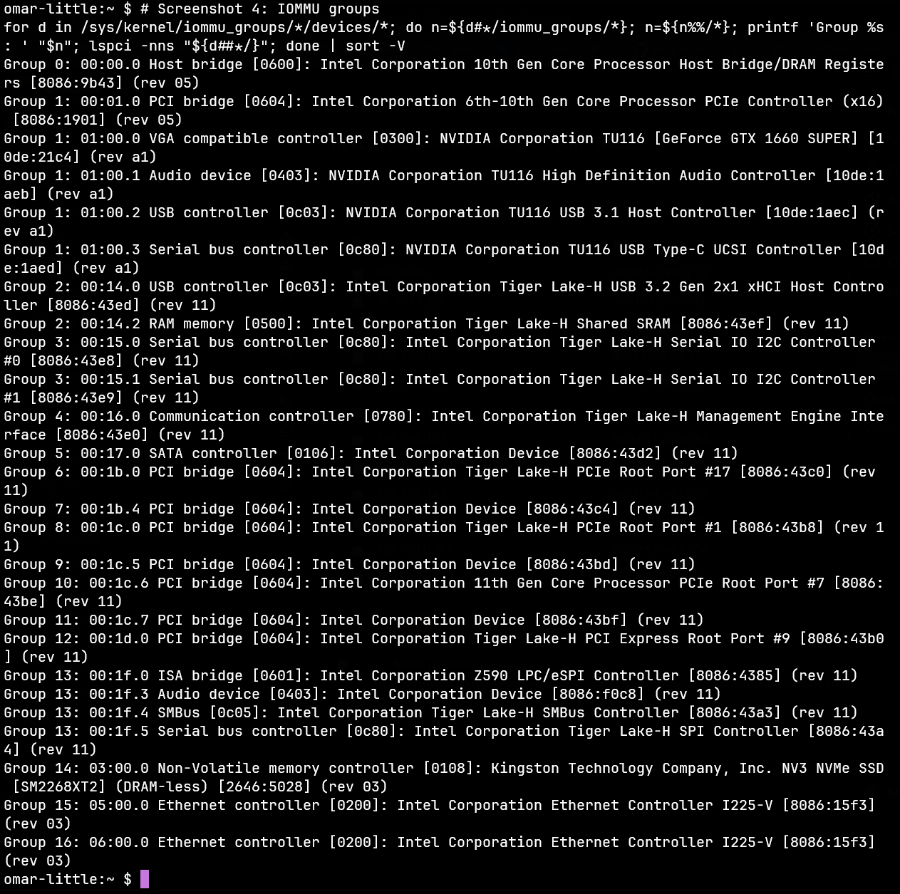
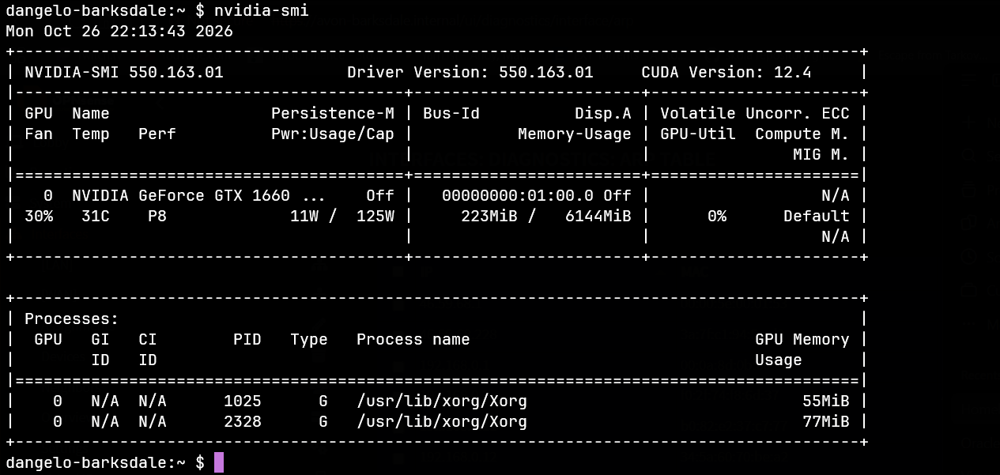
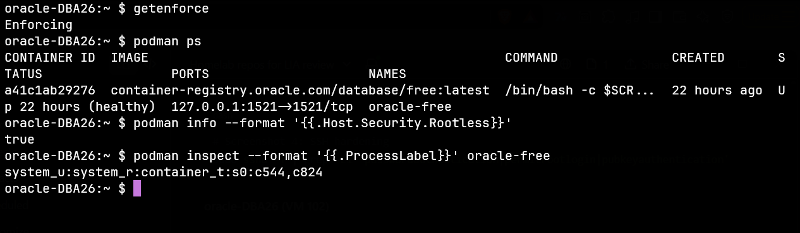

# omar-little — my Proxmox learning server

My old gaming rig, rebuilt into a Proxmox VE server where I learn by building, breaking and rebuilding.

> **TL;DR:** A bare-metal Proxmox VE 9 host on ZFS with two minimal templates (Debian 13 and Oracle Linux 10) and two clones built from them: a **GPU passthrough desktop** with real hardware isolation, and an **Oracle Database lab** running in rootless Podman under SELinux. The key claims below link to a screenshot as proof, collected in the [Evidence](#evidence) table.

**What I aim for:** zero trust, scalable, reliable, and documented — so clearly that someone who has never seen the system can follow it without guessing. I don't always get there. Where I fall short is in [Known limitations](#known-limitations), and any improvement is welcome as an [issue](../../issues).

> **Sanitized on purpose:** usernames, MAC addresses and public IPs are hidden in the screenshots.

**Where DBA fits in:** I'm studying to become a DBA. A database is only as reliable as the server, storage, network and security underneath it, and that's the layer I practice here. I want to be the DBA who understands the whole stack, not just the SQL.

**How this was built:** I followed guides and documentation, with an LLM as a sounding board. The key decisions were mine, like isolating the GPU in hardware instead of using the ACS override. I reinstalled Proxmox several times before I understood ZFS and snapshots, and every reinstall taught me something.

---

## Design decisions

### 1. A type 1 hypervisor, not a desktop app

I wanted to run VMs the way production does: a bare-metal hypervisor with KVM, ZFS, templates and clustering built in, open source and with no license costs. That's Proxmox. ([proof](Images/screenshot-hypervisor-001-overview.png))

### 2. GPU passthrough with real isolation, not the ACS override

A GPU can only be passed to a VM safely when it sits alone in its **IOMMU group**. Mine shared a group with the NVMe drive. The common fix is the ACS override, which only makes Linux *pretend* the devices are isolated. I chose real isolation instead:

1. Enabled VT-d in the BIOS, which made the IOMMU groups visible.
2. Found the NVMe in the GPU's group.
3. **Moved the NVMe to a chipset-connected slot.**
4. Checked again: the GPU was alone in its group.
5. Bound all four GPU functions to `vfio-pci`.

*Group 1 holds only the CPU's PCIe port and the GPU's four functions. The NVMe sits alone in group 14.*

*The end-to-end proof: the GTX 1660 Super working inside the VM with the NVIDIA driver. All four GPU functions are bound to `vfio-pci` on the host ([proof](Images/screenshot-hypervisor-003-gpu.png)). `intel_iommu=on` isn't needed, because current Proxmox kernels enable the Intel IOMMU by default.*

### 3. Templates and linked clones: cattle, not pets

I built minimal, headless templates for **Debian 13** and **Oracle Linux 10** (2 vCPU, 2 GB RAM, 10 GB disk). New VMs are **linked clones**: they store only their own changes on top of the template, and are sized up only as far as the job needs. When one breaks or has done its job, I throw it away and clone a fresh one.

| VM | From template | Sized for | Purpose |
|---|---|---|---|
| 101 dangelo-barksdale | 9100 Debian 13 | 6 vCPU, 8 GB, 24 GB | GPU desktop with XFCE, driving my TV |
| 102 oracle-DBA26 | 9200 Oracle Linux 10 | 2 vCPU, 8 GB, 50 GB | Oracle Database lab, used for my [SQL coursework](https://github.com/johanVcode/the_skool_johan_v) |

Full configurations: [VM 101](Images/screenshot-vm101-001-config.png) · [VM 102](Images/screenshot-vm102-001-config.png).

### 4. Versioned ZFS snapshots before every big change

Every milestone gets a numbered snapshot: `001_fresh-install` on the host, `v001` → `v003` on the GPU desktop, and `v001` → `v002` on the database VM. A failed change rolls back in minutes. ([proof](Images/screenshot-hypervisor-002-zfs.png))

### 5. Least privilege inside the VMs

**Oracle Linux (database lab):** Oracle Database runs in **rootless Podman** under **SELinux in enforcing mode**, and every container gets its own SELinux label. The database port is bound to `127.0.0.1`, so it's only reachable from inside the VM, not from the network.

*`Enforcing`, `Rootless: true`, the container's label `container_t:s0:c544,c824`, and port 1521 bound to localhost only.*

**Debian (desktop):** a Bash script I wrote myself sets up updates, **ufw** (deny incoming by default) and **fail2ban**. AppArmor runs with Debian's default profiles: 15 profiles enforce, and writing my own is something I want to learn next. SSH is key-only, with no root login, on both VMs. On oracle-DBA26 this is set in a `00-hardening.conf` drop-in, so package updates can't override it.

Proof: [ufw + fail2ban](Images/screenshot-vm101-003-firewall.png) · [AppArmor](Images/screenshot-vm101-004-apparmor.png) · [SSH, Debian](Images/screenshot-vm101-005-ssh.png) · [SSH, Oracle Linux](Images/screenshot-vm102-003-ssh.png)

**How I work:** VS Code connects to the database VM over Remote-SSH and opens `~/projects`, where my repos live. That folder is mounted into the Oracle container, so SQL files are edited in VS Code and run by the database without copying anything.

---

## Known limitations

- **The Proxmox firewall is off.** The VMs' network cards are flagged for it, but it isn't enabled at datacenter level, so the only thing between the VMs is my OPNsense firewall, and on the same bridge they can reach each other directly.
- **ZFS runs on a single NVMe.** ZFS can *detect* corruption but can't *repair* it without a second copy, and there are no backups to another machine yet.
- **SSH on the Debian VM is open to the whole LAN,** not only my admin devices.
- **The whole `~/projects` folder is mounted into the database container,** for convenience. The container can read all my repos.
- **The Oracle image uses the `:latest` tag,** so a new pull can change the environment. Production would pin an exact version.

---

## Self-audit, 2026-10-26

I collected evidence from the host and both VMs (the screenshots on this page) and checked it against this README.

- **Fixed:** oracle-DBA26 allowed root login with an SSH key (OpenSSH's default). Disabled with a `00-hardening.conf` drop-in, verified with `sshd -T`, and tested with a fresh login ([proof](Images/screenshot-vm102-003-ssh.png)).

- **Fixed:** two finished projects, the GPU desktop and the database lab, were still listed as next steps.
- **Removed:** a claim about etckeeper that was no longer true.
- **Found, not fixed yet:** the Proxmox firewall is off, and SSH on the Debian VM is open to the whole LAN. Both are listed under Known limitations.

---

## Roadmap

1. **Backups to a separate machine,** which also covers the single-disk risk.
2. **Enable the Proxmox firewall,** and limit SSH to my admin devices.
3. **Learn Ansible:** turn my hardening script into a reusable role, and publish the script here.
4. **Cloud-Init,** so every clone sets its own hostname, user and SSH keys automatically.
5. **Mount one project at a time** into the database container, and pin the Oracle image version.
6. **Move lab VMs to their own VLAN** once my new switch is in place ([homelab-network](https://github.com/johanVcode/homelab-network)).

The long-term goal is a **portable toolkit**: templates plus Ansible playbooks in Git, so I could deploy 50 VMs and configure them all the same way, on any rack.

---

## What I'm still asking

- When does a business choose bare-metal databases over VMs or containers, and why?
- How do professionals back up a ZFS-based hypervisor without stopping the VMs?

If you have answers, I'd love to hear them.

---

## Evidence

Every screenshot, with usernames and MAC addresses hidden.

| Claim | Proof |
|---|---|
| Proxmox VE 9.2, two templates and two clones, 8 cores / 32 GB | [overview](Images/screenshot-hypervisor-001-overview.png) |
| Healthy ZFS pool, linked clones, versioned snapshots | [ZFS](Images/screenshot-hypervisor-002-zfs.png) |
| All four GPU functions bound to `vfio-pci` | [vfio-pci](Images/screenshot-hypervisor-003-gpu.png) |
| GPU alone in its IOMMU group, NVMe in its own | [IOMMU groups](Images/screenshot-hypervisor-004-iommu.png) |
| One LAN bridge; Proxmox firewall disabled (see limitations) | [host network](Images/screenshot-hypervisor-005-network.png) |
| VM 101: GPU passthrough config, linked clone of 9100 | [config](Images/screenshot-vm101-001-config.png) |
| VM 101: GPU working inside the VM | [nvidia-smi](Images/screenshot-vm101-002-gpu.png) |
| VM 101: ufw deny-by-default, fail2ban running | [firewall](Images/screenshot-vm101-003-firewall.png) |
| VM 101: AppArmor status | [AppArmor](Images/screenshot-vm101-004-apparmor.png) |
| VM 101: key-only SSH, no root login | [SSH](Images/screenshot-vm101-005-ssh.png) |
| VM 102: linked clone of 9200, sized for the database | [config](Images/screenshot-vm102-001-config.png) |
| VM 102: SELinux enforcing, rootless Podman, DB on localhost | [Podman](Images/screenshot-vm102-002-podman.png) |
| VM 102: key-only SSH, no root login (after the fix) | [SSH](Images/screenshot-vm102-003-ssh.png) |

---

## Reference

<b>Hardware</b>

| Part | Choice |
|---|---|
| CPU | Intel i7-10700K, 8 cores / 16 threads (integrated graphics for the host) |
| Motherboard | ASUS ROG Strix Z590-E |
| RAM | 32 GB DDR4 |
| Storage | 500 GB Kingston NV3 NVMe, ZFS (single disk) |
| GPU | NVIDIA GTX 1660 Super (passthrough) |
| Network | 2 × Intel I225-V 2.5 GbE (one in use) |

<b>Sources</b>

**Main source: the [ArchWiki](https://wiki.archlinux.org/).** Proxmox runs on Debian, and the ArchWiki explains how Linux itself works (systemd, daemons, kernel modules, SSH), so nearly everything translates directly. The main difference is the package manager: `pacman` on Arch, `apt` on Debian and `dnf` on Oracle Linux. Key pages:

- [PCI passthrough via OVMF](https://wiki.archlinux.org/title/PCI_passthrough_via_OVMF): IOMMU groups and `vfio-pci`
- [OpenSSH](https://wiki.archlinux.org/title/OpenSSH), together with `man sshd_config`: SSH hardening
- [systemd](https://wiki.archlinux.org/title/Systemd): services and daemons

**Also used:**

- [Debian Wiki: VGA Passthrough](https://wiki.debian.org/VGAPassthrough): GPU passthrough on Debian
- [Proxmox VE documentation](https://pve.proxmox.com/pve-docs/): Proxmox-specific parts, like templates, linked clones and ZFS storage
- [Podman documentation](https://docs.podman.io/): rootless containers
- Guides and video tutorials, with an LLM as a sounding board

